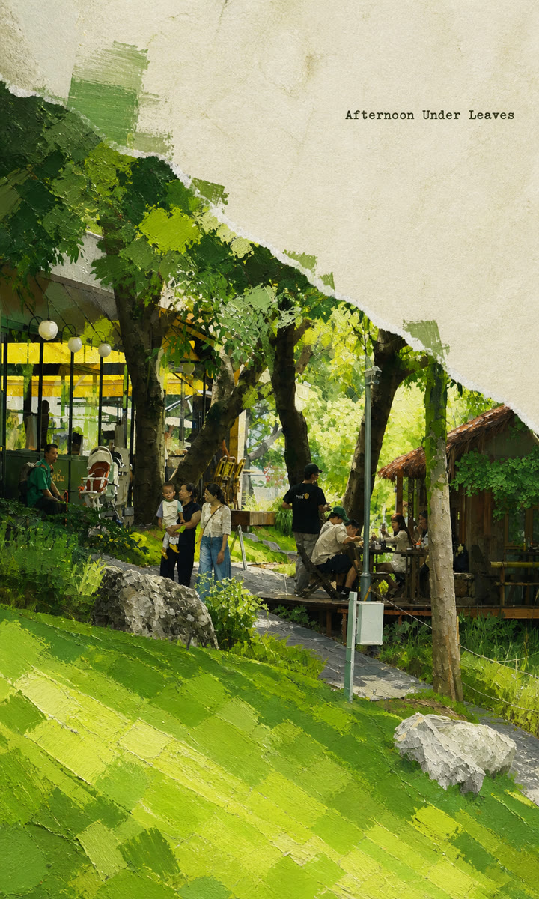
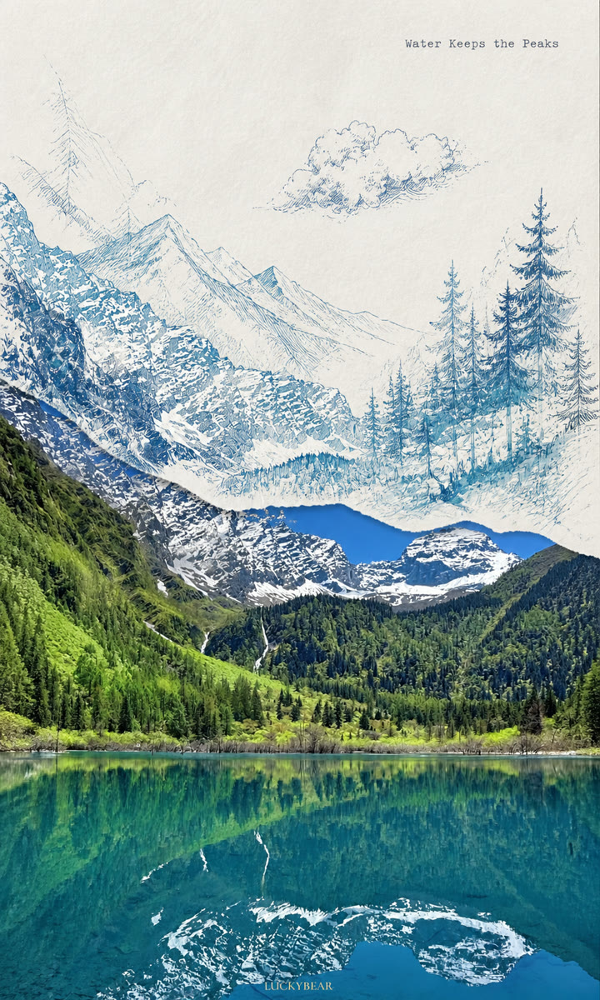

# Photo Zine Collage

`photo-zine-collage` is a Codex skill for turning a user-supplied photograph into a handmade 3:5 portrait zine collage. It keeps the photograph as the factual anchor, derives a palette from the source, and extends the scene through torn-paper transitions and painterly illustration.

The skill supports two visual modes:

- `impressionist-blocks` — broad oil-painted color masses with visible bristle movement.
- `realist-fine-lines` — restrained, naturalistic linework with airy painted detail.

## Previews

| Impressionist blocks | Realist fine lines |
| --- | --- |
|  |  |
| Garden café | Mountain lake |

## 中文简介

这是一个将用户照片转换为 3:5 竖版撕纸拼贴 zine 的 Codex skill。它会保护照片中的人物、场景几何和原始色彩，并根据源图选择版式、提取调色板、生成一条简短英文微文案，再调用可用的图像编辑工具完成作品。

## What it does

- Selects from eight source-informed layouts, including upper/lower bands, offset compositions, diagonals, and split fragments.
- Extracts a weighted source palette and carries it into the generation prompt.
- Creates one scene-matched English micro-text line locally and deterministically, or accepts exact wording or a text-free request.
- Sends a bounded working copy to the image editor while retaining the original locally; small standard JPEGs are copied byte-for-byte instead of being expanded to PNG.
- Restores an ungraded original-photo fragment on every normal run.
- Uses one remote generation by default and never retries automatically.
- Provides palette comparison and failure-specific quality gates.
- Preserves existing signatures, provenance marks, and watermarks.

## Requirements

- Python 3.10 or newer.
- Pillow 10.x, 11.x, or 12.x.
- Codex or ChatGPT with access to image input and an image generation/editing capability.

Install the Python dependency from the repository root:

```bash
python3 -m pip install -r requirements.txt
```

## Install the skill

For local Codex use, ask `$skill-installer` to install the skill from this repository URL. You can also place the repository directory at one of Codex's supported skill locations, for example:

- User scope: `$HOME/.agents/skills/photo-zine-collage`
- Repository scope: `$REPO_ROOT/.agents/skills/photo-zine-collage`

Codex detects skill changes automatically; restart Codex if the skill does not appear. See the [official OpenAI skill documentation](https://developers.openai.com/codex/skills) for current discovery and installation guidance.

## Use

Attach or reference a photograph and invoke the skill explicitly:

```text
Use $photo-zine-collage to turn this photo into a realist fine-line zine.
```

If no style is supplied, the skill asks for one choice before continuing. Useful requests include:

```text
Use $photo-zine-collage to create an impressionist-blocks zine from this photo.
Use $photo-zine-collage with the exact micro-text "Still Water".
Use $photo-zine-collage and make the result text-free.
```

The normal fast path is:

1. Run one batched local preparation command for the working copy, palette, prompt, and deterministic finishing plan.
2. Generate once through an available image-editing tool.
3. Run one batched local finishing command for exact source-pixel restoration, micro-text, and palette audit.
4. Review the final image once.

The full operating instructions live in [`SKILL.md`](SKILL.md).

## Deterministic helpers

Run the batched helpers from the repository root:

```bash
python3 scripts/collage_pipeline.py prepare \
  --source path/to/photo.jpg \
  --output-dir path/to/output \
  --stem sample \
  --style realist-fine-lines \
  --scene "a person walking along diagonal stone steps" \
  --must-keep "identity, pose, stair perspective, and original colors" \
  --layout diagonal-rise \
  --crop-center 0.5,0.5 \
  --micro-text "Light Between Steps"

python3 scripts/collage_pipeline.py finish \
  --generated path/to/generated.png \
  --source path/to/photo.jpg \
  --plan path/to/output/sample-finishing-plan.json \
  --output path/to/output/sample-final.png
```

The lower-level single-purpose helpers remain available for debugging and custom workflows.

## Scope and limitations

- Produces a single portrait zine image, not a multi-page publication.
- Does not provide print production, CMYK conversion, bleed, binding, PDF export, or batch processing.
- Final painterly rendering quality depends on the image generation/editing tool; exact typography is rendered locally.
- Automatic layout and fallback micro-text use the agent-authored scene description; they do not perform independent computer vision.
- Palette comparison is a global diagnostic and does not replace visual inspection of skin, products, provenance marks, or other local colors.
- The fast path uses stable per-layout restoration footprints and a preselected crop center. A custom anchor box remains available for nonstandard layouts.

## Privacy and source images

Source photographs are user data. The skill instructs the agent not to browse for, upload separately, or commit them unless the user asks. Local test sources and generated experiments belong in `test-output/`, which is excluded by `.gitignore`.

No source photographs are included in the public source set. The two generated previews above were explicitly selected for publication and exported as reduced-size, metadata-checked derivatives. Add further previews only when their publication rights and metadata have been reviewed.

## Development

Run the automated tests:

```bash
python3 -m unittest discover -s tests -v
```

The test suite covers the batched fast path, byte-identical JPEG reuse, working-copy preparation, palette extraction, both prompt styles, layout selection, local micro-text, image normalization, anchor restoration, and palette comparison.

## License

Released under the [MIT License](LICENSE).
